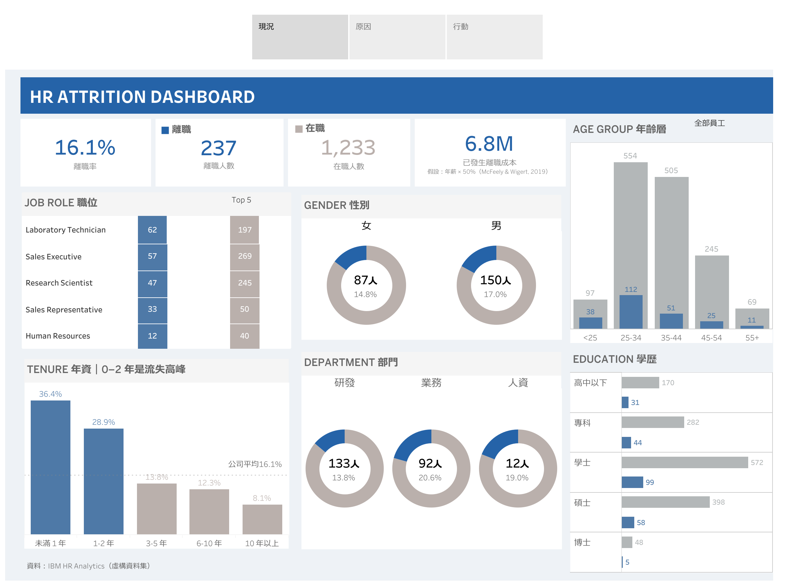
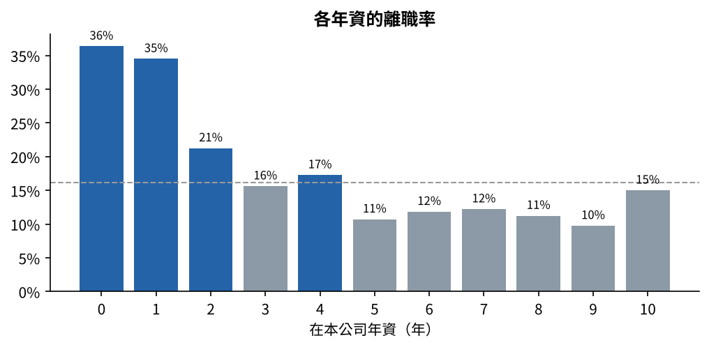
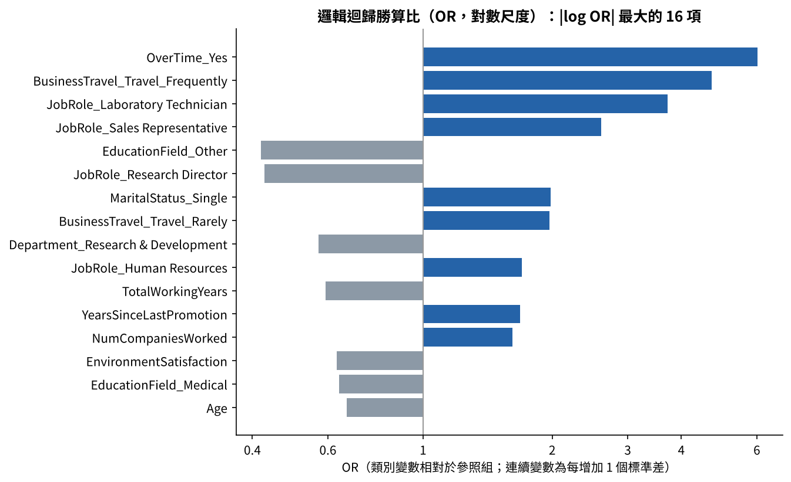
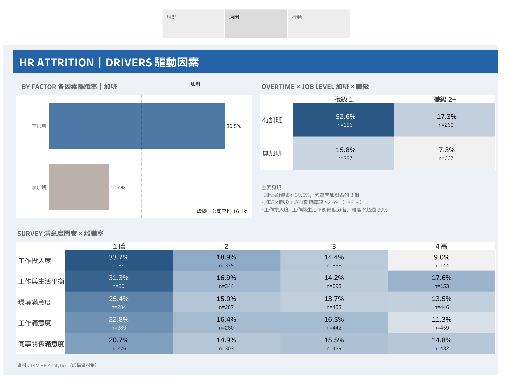
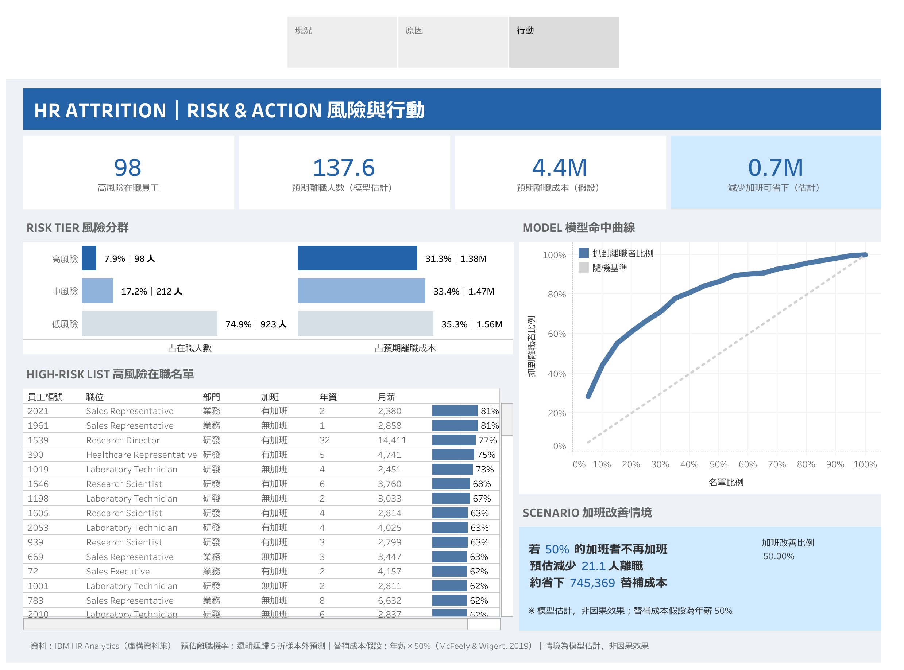

# 員工離職分析：找出原因、鎖定高風險員工、估算留任效益

**HR Attrition Analysis｜Python（EDA、統計檢定、邏輯迴歸）＋ Tableau 互動儀表板**

🔗 **互動儀表板（Tableau Public）**：[HR Attrition Dashboard](https://public.tableau.com/app/profile/chun.liao/viz/HRAttritionDashboard_17944107821470/HR)
📓 **分析筆記本**：[`notebooks/hr_attrition_analysis.ipynb`](notebooks/hr_attrition_analysis.ipynb)



---

## 一句話結論
公司離職率 16.1%，**加班是最強、也最能管理的風險因素**（有加班者離職率 30.5%，未加班者 10.4%）；用模型鎖定**占在職 8% 的高風險員工**，就能涵蓋約三成的預期離職成本，讓 HR 把有限的面談與留任資源放在最有效的地方。

---

## 1. 商業問題
HR 主管想回答三個問題，對應儀表板的三頁：

| 問題 | 要支援的決策 | 儀表板頁面 |
|---|---|---|
| 離職集中在哪些部門、職位、年資？ | 該優先關注哪些團隊 | 現況（總覽） |
| 哪些工作條件和離職最相關？ | 該調整哪些制度（加班、出差、股票配發） | 原因（驅動因素） |
| 哪些在職員工最可能離開？介入能省多少？ | 留任面談名單、預算是否值得投入 | 行動（風險與行動） |

## 2. 資料
- **來源**：[IBM HR Analytics Employee Attrition & Performance（Kaggle）](https://www.kaggle.com/datasets/pavansubhasht/ibm-hr-analytics-attrition-dataset/data)
- **規模**：1,470 名員工、35 個欄位；離職 237 人（16.1%），為不平衡的二元分類問題。
- **內容**：人口統計（年齡、性別、婚姻、學歷）、工作條件（部門、職位、職級、加班、出差、通勤距離）、薪酬（月薪、加薪幅度、股票選擇權）、年資，以及 5 題 1–4 分的滿意度問卷。
- **性質**：IBM 資料科學家建立的**虛構資料集**，結論只代表這份資料，不代表任何真實公司。
- **限制**：單一時間點的快照，**沒有日期欄位**，無法做離職趨勢或存活分析；所有發現皆為相關，不是因果。

## 3. 資料整理
資料本身沒有缺值與重複列，整理重點在「判斷哪些欄位可信」與「轉成可讀、可分析的格式」：

1. **完整性檢查**：缺值 0、重複列 0、員工編號唯一。
2. **刪除無資訊欄位**：`EmployeeCount`、`StandardHours`、`Over18` 只有單一值。
3. **辨識不可信的欄位**：`DailyRate`、`HourlyRate`、`MonthlyRate` 名稱像薪資，但與 `MonthlyIncome`、職級幾乎無相關，判斷為隨機產生；**薪酬分析只用 `MonthlyIncome`**（與職級相關係數約 0.95）。
4. **代碼轉標籤**：依官方資料字典，把學歷、滿意度等 1–5 分代碼轉成「學士」「非常高」等可讀標籤。
5. **建立分組**：年齡層、年資級距、月薪級距、通勤距離、距上次升遷年數，方便比較離職率。
6. **產出 Tableau 用資料表**：員工明細（含模型風險分數）、問卷長表、各因素離職率與 95% 信賴區間、模型命中表。

## 4. 方法與工具
| 步驟 | 方法 | 工具 |
|---|---|---|
| 探索式分析 | 各組離職率＋ Wilson 95% 信賴區間、交叉分析 | pandas、matplotlib、seaborn |
| 統計檢定 | 類別變數：卡方檢定＋ Cramér's V；數值變數：Mann-Whitney U ＋ rank-biserial；Benjamini-Hochberg 校正多重比較 | SciPy |
| 預測模型 | 邏輯迴歸（L2 正則化），與隨機森林、梯度提升樹比較；分層切分＋ 5 折交叉驗證；主要指標 PR-AUC | scikit-learn |
| 風險分數 | 以 5 折**樣本外預測**為每位員工估計離職機率，分成高／中／低風險 | scikit-learn |
| 商業試算 | 替補成本假設為年薪 × 50%，附 21%／100% 敏感度分析；加班改善情境 | pandas |
| 視覺化 | 三頁互動儀表板，以 Story 串成「現況 → 原因 → 行動」 | Tableau Public |

## 5. 主要發現
| 發現 | 證據 |
|---|---|
| **加班是最強、且可管理的風險因素** | 離職率 30.5% vs 10.4%；控制其他共變數後，有加班者的離職勝算約為無加班者的 6 倍（OR = 6.03） |
| **前兩年是流失高峰** | 年資 0–2 年離職率約 29–36%，3 年起降到 10–15% |
| **風險會疊加** | 加班 × 職級 1：52.6%（156 人）；再加上單身：67.8%（59 人） |
| **職位差異大於部門差異** | Sales Representative 約 40%，Research Director、Manager 不到 5% |
| **股票選擇權與滿意度有保護效果** | 無股票選擇權 24.4%；工作投入度最低分者 33.7%、工作與生活平衡最低分者 31.3% |
| **同職級男女薪資無顯著差異** | 各職級月薪中位數差距在 ±3% 內，檢定皆不顯著 |

<p align="center">
  
  
</p>

### 模型表現
- 邏輯迴歸優於樹模型（5 折 CV PR-AUC 0.65 vs 0.56–0.58）：資料量小、訊號大致線性，可解釋的模型反而最好。
- 測試集 ROC-AUC 0.81、PR-AUC 0.59（隨機猜測基準 0.16）。
- **商業解讀**：只關懷風險最高的 20% 員工，就能涵蓋約六成離職者，命中率約為隨機挑人的 3 倍。

## 6. 建議行動
| 決策 | 依據 | 建議追蹤指標 |
|---|---|---|
| 監控部門加班時數，設定上限或輪替；加班者列入季度關懷 | 加班 OR = 6.03；模型估計加班減半可少約 21 人離職 | 各部門加班比例、加班者離職率 |
| 強化到職 90 天計畫與導師制度，第 12 個月做留任面談 | 年資 0–2 年離職率約為公司平均的 2 倍 | 新人 12 個月留任率 |
| 每季依風險名單安排主管面談，資源集中在高風險族群 | 高風險 98 人（在職 8%）占約 31% 預期離職成本 | 名單上員工的實際離職率 |
| 檢視職級 1 薪資帶，評估把股票配發延伸到職級 1–2 | 職級 1 離職率 26%；無股票選擇權 24.4% | 職級 1 離職率、股票覆蓋率 |
| 問卷投入度或工作與生活平衡最低分，自動觸發主管面談 | 最低分者離職率超過 30% | 低分者後續 6 個月離職率 |

> 情境數字為模型估計，非因果效果；替補成本為情境假設。實際導入時應以 A/B 或分批試行驗證效果。

## 7. 儀表板
| 現況 | 原因 | 行動 |
|---|---|---|
|  |  |  |

- **現況**：KPI、部門／職位／年資／人口統計分布；點任一圖即可篩選整頁，並可切換「只看離職」。
- **原因**：可切換 18 個因素的離職率排行、加班 × 職級矩陣、滿意度問卷熱圖。
- **行動**：風險分群（人數 vs 成本）、模型命中曲線、高風險在職名單、加班改善情境滑桿。

## 8. 限制與下一步
- 虛構資料、單一時間點、無因果識別；成本為情境假設（McFeely & Wigert, 2019；Boushey & Glynn, 2012）。
- 若導入真實資料：以**時間切分**驗證模型（用過去預測未來），並加入離職日期做存活分析。
- 留任措施應以試行計畫評估實際效果，而非直接採用模型情境數字。

## 專案結構
```
hr-attrition/
├── data/
│   └── WA_Fn-UseC_-HR-Employee-Attrition.csv   # 原始資料（Kaggle，ODbL）
├── notebooks/
│   └── hr_attrition_analysis.ipynb             # 主要分析（含輸出）
├── outputs/
│   ├── figures/                                # 筆記本產生的圖
│   └── tableau/                                # 匯出給 Tableau 的資料表
├── images/                                     # README 用的儀表板截圖
├── requirements.txt
└── README.md
```

## 如何重現
```bash
git clone <this-repo>
cd hr-attrition
python -m venv .venv && source .venv/bin/activate   # Windows: .venv\Scripts\activate
pip install -r requirements.txt
jupyter lab notebooks/hr_attrition_analysis.ipynb
```
圖表使用中文字型（Noto Sans CJK TC、微軟正黑體或蘋方）。Linux 若出現方框，請安裝 `fonts-noto-cjk` 後重開 kernel。

## 資料來源與授權
- 資料：[IBM HR Analytics Employee Attrition & Performance](https://www.kaggle.com/datasets/pavansubhasht/ibm-hr-analytics-attrition-dataset/data)，Kaggle。授權：Database — [Open Database License (ODbL)](https://opendatacommons.org/licenses/odbl/1-0/)；Contents — [Database Contents License (DbCL)](http://opendatacommons.org/licenses/dbcl/1.0/)。
- 儀表板版面參考：Pradeep Kumar G，〈HR Attrition Dashboard〉，Tableau Public。

## 參考文獻
- Boushey, H., & Glynn, S. J. (2012). *There are significant business costs to replacing employees*. Center for American Progress. https://www.americanprogress.org/article/there-are-significant-business-costs-to-replacing-employees/
- McFeely, S., & Wigert, B. (2019, March 13). *This fixable problem costs U.S. businesses $1 trillion*. Gallup. https://www.gallup.com/workplace/247391/fixable-problem-costs-businesses-trillion.aspx
- 統計方法文獻（Benjamini & Hochberg, 1995；Saito & Rehmsmeier, 2015 等）見筆記本最後的「參考文獻」。
